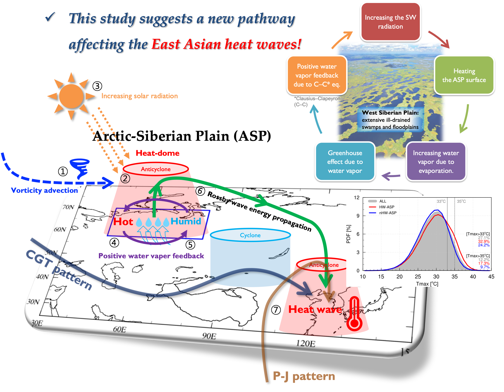
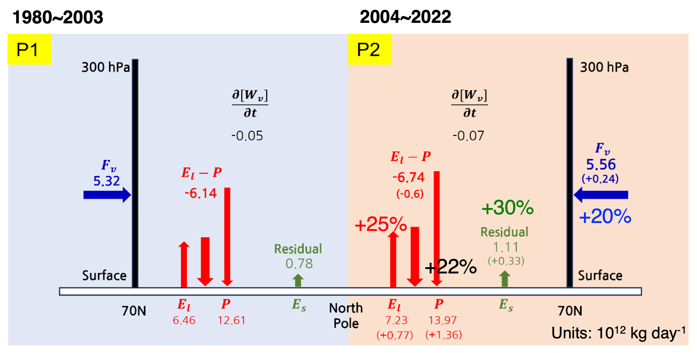
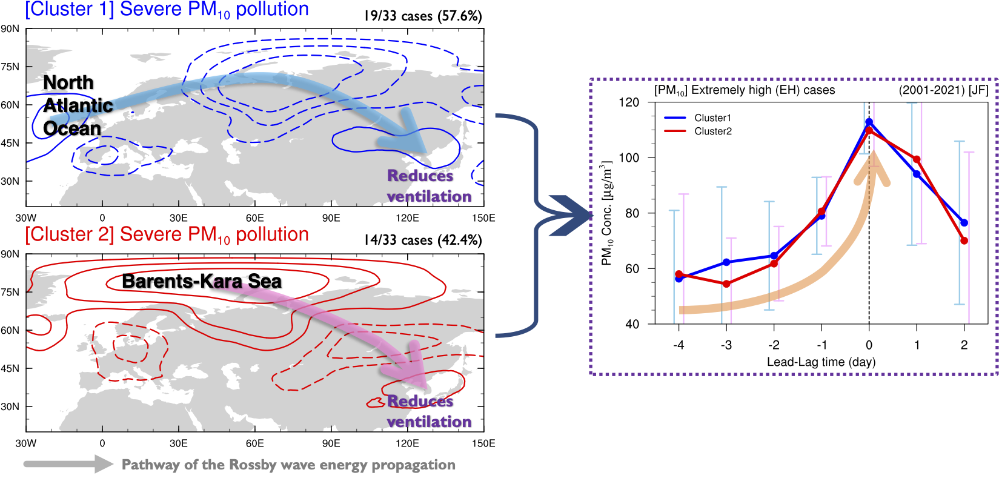

  I study how <b>large-scale atmospheric circulation links remote climate changes</b>, especially in the Arctic and high latitudes,
  to <b>regional extremes</b> such as heatwaves, compound extremes and severe air pollution in East Asia and Europe.

  Heatwaves
  Compound Extremes
  Teleconnections
  Arctic Amplification
  Regional Reanalysis
  Air Quality

<section id="heatwaves" class="rs-row">
  

    
  

  

    <h2>Heatwave Mechanisms by Large-scale Teleconnection Patterns</h2>
    

      How do remote circulation patterns, such as the Arctic-Siberian Plain (ASP) pattern, the circumglobal teleconnection (CGT)
      and the Eurasian summertime intraseasonal oscillation (ESISO), set up extreme heat and compound extremes?
      I diagnose these pathways in observations and evaluate how well CMIP6 models reproduce them.
    

    
East Asia &amp; South Korea

    

      <a class="rs-chip" href="https://doi.org/10.1002/joc.5869">Kim et al. (2019) · <em>Int. J. Climatol.</em></a>
      Kim et al. (2021) · <em>Korean J. Quat. Res.</em>
      <a class="rs-chip" href="https://doi.org/10.1038/s41598-022-22628-9">Kim et al. (2022) · <em>Sci. Rep.</em></a>
      <a class="rs-chip" href="https://doi.org/10.1016/j.wace.2026.100867">Kim et al. (2026) · <em>WACE</em></a>
      <a class="rs-chip" href="https://doi.org/10.1016/j.wace.2026.100865">Nam et al. (2026) · <em>WACE</em></a>
    

    
Eurasia &amp; Europe

    

      <a class="rs-chip" href="https://doi.org/10.1016/j.wace.2024.100729">Kim et al. (2024) · <em>WACE</em></a>
      <a class="rs-chip" href="https://doi.org/10.1038/s41612-026-01549-8">Kim et al. (2026) · <em>npj Clim. Atmos. Sci.</em></a>
    

  

</section>

<section id="arctic" class="rs-row">
  

    
  

  

    <h2>Mechanism of the Arctic Amplification Change</h2>
    

      Why has wintertime Arctic warming accelerated? I examine abrupt changes in the Arctic atmospheric water budget,
      including poleward moisture transport, evaporation and precipitation, as drivers of the recent shift in Arctic amplification.
    

    

      <a class="rs-chip" href="https://doi.org/10.15531/KSCCR.2025.16.4.729">Son et al. (2025) · <em>J. Clim. Change Res.</em></a>
    

  

</section>

<section id="reanalysis" class="rs-row rs-nofig">
  

    <h2>Performance Evaluation of Regional Climate Reanalysis (RRJ-ClimCORE)ONGOING</h2>
    

      RRJ-ClimCORE is a new 5-km regional reanalysis over East Asia. I evaluate its precipitation climatology and extreme rainfall
      events against dense station observations over South Korea, to assess its value as a reference dataset for regional climate studies.
    

  

</section>

<section id="air-pollution" class="rs-row">
  

    
  

  

    <h2>Air Pollution by Large-scale Teleconnection Patterns</h2>
    

      Severe particulate-matter episodes in Korea are not only local events. I link them to remote climate drivers, such as
      Arctic sea ice and North Atlantic–Arctic atmospheric variability, which weaken ventilation over East Asia through Rossby-wave teleconnections.
    

    

      <a class="rs-chip" href="https://doi.org/10.3390/atmos10100619">Kim et al. (2019) · <em>Atmosphere</em></a>
      <a class="rs-chip" href="https://doi.org/10.1016/j.envpol.2021.118051">Kim et al. (2021) · <em>Environ. Pollut.</em></a>
      <a class="rs-chip" href="https://doi.org/10.1016/j.scitotenv.2023.169714">Kim et al. (2024) · <em>Sci. Total Environ.</em></a>
      <a class="rs-chip" href="https://doi.org/10.5572/KOSAE.2024.40.5.491">Hyun et al. (2024) · <em>J. Korean Soc. Atmos. Environ.</em></a>
      <a class="rs-chip" href="https://doi.org/10.1016/j.atmosenv.2025.121122">Lee et al. (2025) · <em>Atmos. Environ.</em></a>
    

  

</section>

